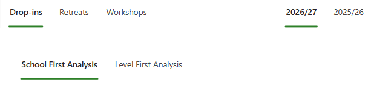
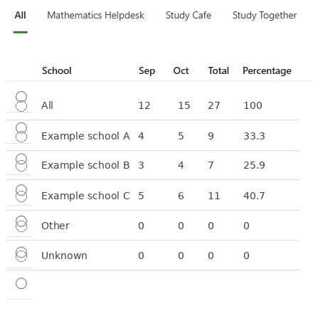

# Analysis

This is currently still under development but can perform several analyses of the inputted data.

It allows analysis of:

- Drop-ins, Retreats or Workshops.
- The current academic year or the previous academic year.
- School or level.

## Choose analysis filters

Select the event type, academic year and whether to start with School First Analysis or Level First Analysis.

## Explore the results

After choosing the filters, the app presents a monthly attendance table for the selected event type and grouping. Select a school or level in the table to drill further into the data.

Clicking on any of the schools/levels in the table will dive even further into the data. By scrolling down the screen, you will see how the selected data is broken down by: 

- Level or school.
- Course.
- Course type.
- Location (in-person or online).
- Topic.

Select a table heading to sort in ascending order; select it again to sort in descending order.

