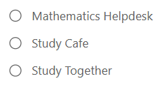
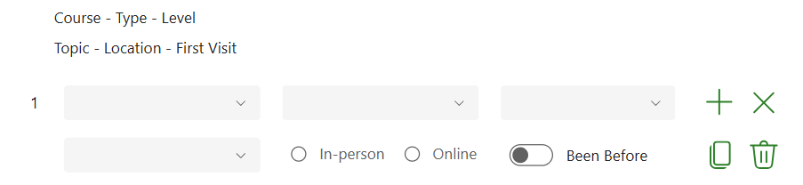

# Drop-ins

Use this section to enter and view attendance for the Mathematics Helpdesk, Study Café and Study Together.

## Select the drop-in area and date

1. Select the radio button for the relevant area.
2. The date changes to the last occurrence of that event. For example, selecting Study Café moves the date to the nearest previous Wednesday.
3. If data already exists for that date, it appears in the register.
4. Change the date if you need to enter or review a different occurrence.

## Enter attendance for a new register

If no data has previously been entered for the selected event and date, the app displays a blank register.

From left to right, then top to bottom:

1. Choose the student's course.
2. Choose the course type: undergraduate (UG), postgraduate (PG) or apprentice.
3. Choose the course level.
4. Choose the topic the student enquired about.
5. Select whether the visit was in-person or online.
6. Set whether the student has been before. The off toggle represents the student has attended before; the on toggle represents that this is the student's first visit.

## Add or remove rows

- Select the **plus** icon to add a blank row.
- Select the **copy** button below the plus icon to create a row copied from the row where you selected it.
- The **X** icon clears all data in a row.
- The **bin** icon deletes the student row from the attendance list.

## Save attendance

Adding or changing rows does **not** save the data automatically. You can enter all attendees before saving, or save a partially completed register and continue later. Use **Save Records** in the sidebar.

If there were no attendees, select the event and date as usual. The app displays **No Attendance** instead of **Save Records**. Select **No Attendance** to record zero attendance.
