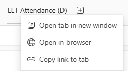

# Getting started

## Open the dashboard

1. Open the **Admin Requests** channel in Microsoft Teams.
2. Find the tab area across the top of the posts.
3. Find **LET Attendance (D)**. If it is not visible, select the plus sign (`+`) and check the available tabs.
4. Right-click **LET Attendance (D)** and choose **Open tab in new window**.

**Note**: you can also left click on the LET Attendance (D) which opens the app inside of the channel – this stops you using other parts of teams and does have some memory leak issues 

## Main areas of the app

- **Drop-ins:** enter and view attendance for the Mathematics Helpdesk, Study Café and Study Together.
- **Retreats:** add retreat attendance and view previous retreat data.
- **Workshops:** add workshop data and view or edit existing workshop records.
- **Tools:** view, add, edit or remove course and topic information.
- **Analysis:** explore attendance data already entered into the app.

Choose a topic from the navigation to follow the relevant task instructions.
