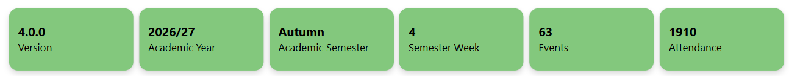
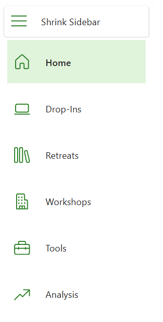
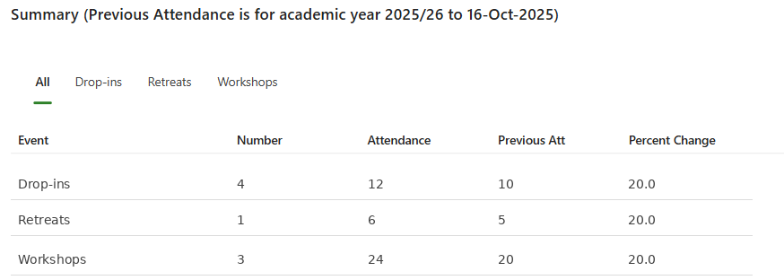

# Home screen

The home screen has three main sections: the side navigation bar, the top information banner and the attendance summary area.

## Top information banner

The banner displays, from left to right:

- The version of the app currently running.
- The current academic year.
- The current academic semester (Autumn or Spring).
- The current semester week.
- The total number of events delivered by LET.
- The total attendance at LET events.

**Note** If the version number box shows **Please Update**, then please use the **Refresh** button that is in a banner overlaying the app's screen.

## Side navigation

Use the navigation sidebar to move between screens.

- **Shrink sidebar:** minimise the sidebar so that only icons remain.

- **Home:** return to the home page. The active area is highlighted.

- **Drop-ins:** enter and view drop-in attendance.

- **Retreats:** enter and view retreat attendance.

- **Workshops:** enter and view workshop attendance.

- **Tools:** view, add, delete or update course and topic information.

- **Analysis:** analyse attendance data that has been entered.

Select the relevant title or icon. Some screens provide additional actions, such as saving attendance data.

## Attendance summary

The main window summarises event and attendance counts. You can view all event types or filter by Drop-ins, Retreats or Workshops. It also compares attendance with the corresponding date in the previous year.

