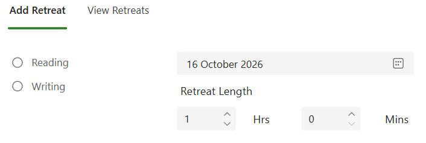
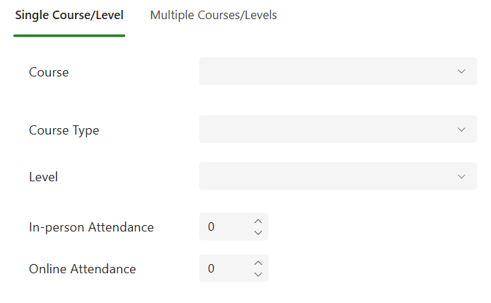
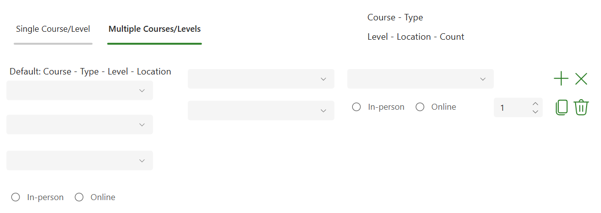

# Retreats

The Retreats section lets you add a retreat or view previous retreat data.

## Set up a retreat

1. Choose the event.
2. Choose the event date.
3. Enter the length of the event in hours and minutes.
4. Choose whether the retreat covers one course and level or multiple courses and/or levels.

## Single course and level

For a retreat covering one course and level, enter:

- Course.
- Course type (UG, PG or Apprentice).
- Course level.
- Number attending in person.
- Number attending online.

When complete, select **Save Record** in the navigation sidebar.

## Multiple courses or levels

Use the attendance register on the right side of the form. For each row, enter the course, course type, level and whether attendance was in-person or online.

The **number** control counts how often the exact combination of student information occurs. If several attendees share the same details, enter a count rather than repeating identical rows.

- **Plus:** adds a new row.
- **Copy:** creates a row using the selected row's information.
- **X:** clears information from a row.
- **Bin:** deletes the row.

The left side of the form can set defaults for the table rows. For example, setting course type to PG and level to 7 fills those values into each row.

When complete, select **Save Records** in the navigation sidebar.
