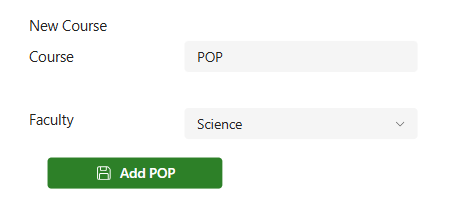
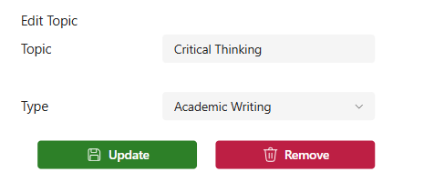

# Tools

The Tools section has three options: **Information and Status**, **View/Edit Courses** and **View/Edit Topics**.

## Information and Status

This is just some technical information; you want to see all green ticks and no crosses. 

## View/Edit Courses

Course information is selected from drop-down lists in Drop-ins, Retreats and Workshops. Use View/Edit Courses to add, edit or remove items from those lists.

### Add a course

1. In the **New Course** box, enter the course code (usually a three-letter code).
2. Choose the faculty the course belongs to.
3. Select the **Add** button in that box.

### Edit or remove a course

1. Select the course in the table of available courses.
2. Change the information if you are editing it.
3. Select **Update** or **Remove** in the Edit Course box.

## View/Edit Topics

Adding, editing or removing topics works similarly to course management. Enter the topic name and choose whether it is an academic writing topic or a mathematics topic.

