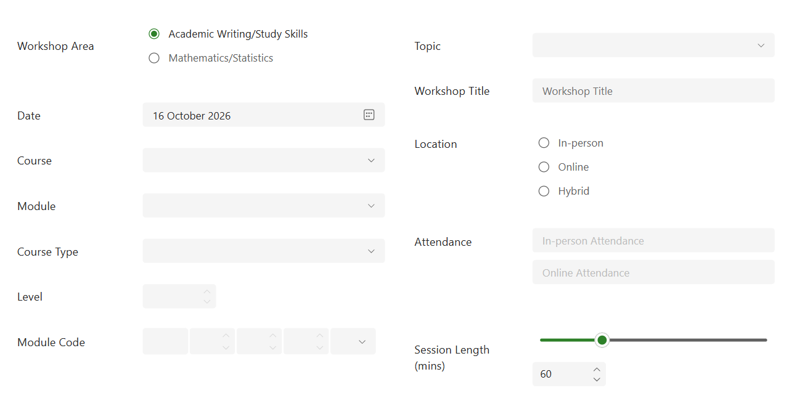
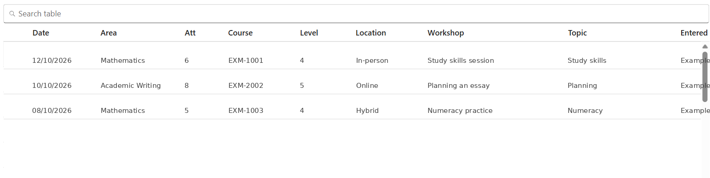
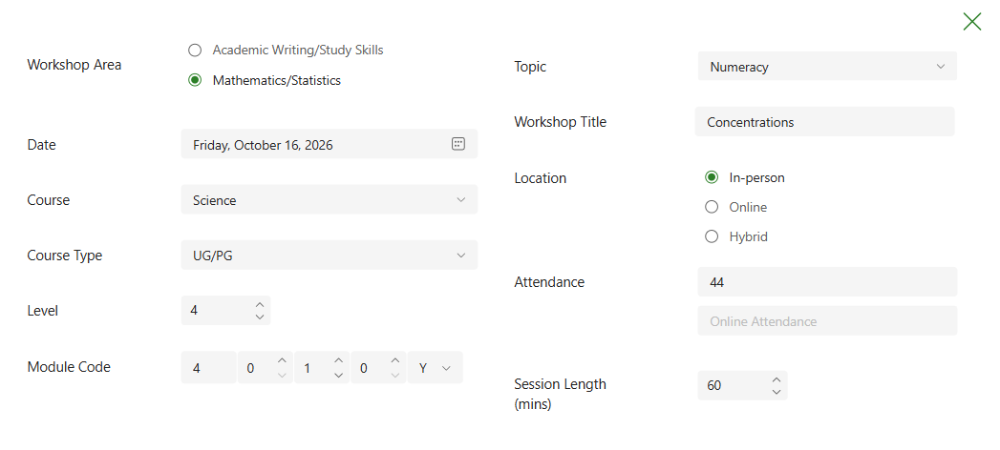
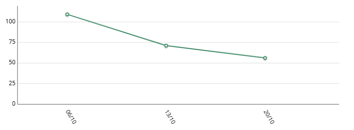

# Workshops

The Workshops section lets you add workshop data, review and edit previous workshop records, and track attendance for modules.

## Add a workshop

1. Select **Add Workshop** at the top of the form.
2. Choose the workshop area: academic writing or mathematics/statistics.
3. Enter the date and workshop course.
4. Either choose a module from the **Module** drop-down, which fills in the related fields, or enter the details manually.

When entering details manually, enter include **course type** (UG, PG or Apprenticeship), **level** and **module code**. Leave the module fields blank if the course is not associated with a particular module.

On the right side of the form, enter:

- Topic of the workshop.
- Workshop title.
- Whether it was in-person, online or hybrid.
- In-person and online attendance counts.
- Session length in minutes. You can type a number or use the slider, which changes in 15-minute intervals.

When complete, select **Save Record** in the navigation sidebar.

## View or edit workshops

1. Select **View/Edit Workshops**.
2. The table lists workshops entered for the current academic year.
3. Search the table by entering text such as a course code or topic.
4. Select a row. A **View/Edit** button appears in the navigation sidebar.
5. Select **View/Edit** to open the workshop record.

Edit the information as needed, then select **Update Record** in the sidebar.

### Delete a workshop

The **Delete Record** button permanently removes the workshop from the data and the source manual states that this cannot be reversed. Use this action with care. 

Select the **X** in the top-right corner to close the record and return to the list.

## Module Viewer

The **module viewer** allows you to track attendance by date for individual modules.

1. Select **Module Viewer**.
2. From the list of modules (e.g. ABC-4321X) select the module of interest.

You will now see a table showing information about the workshops within this module. If there are more than one workshops within this module, you will also see a date by attendance line graph.

